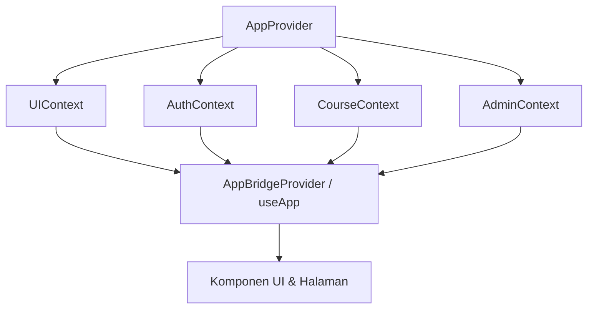

# DIDIKARA (NHCIE LMS) — Arsitektur Sistem & Spesifikasi Teknis

Dokumen arsitektur resmi platform pelatihan, sertifikasi profesional, dan analitik tenaga kerja berbasis AI **DIDIKARA** (Diperbarui: Oktober 2026).

---

## 1. Stack Teknologi & Konvensi

| Komponen | Spesifikasi / Pustaka | Keterangan & Rationale |
|---|---|---|
| **Framework** | Next.js **16.2.12** (App Router, Turbopack) | Mengikuti konvensi App Router modern: `src/proxy.js` untuk edge routing guard, metadata Open Graph dinamis, `sitemap.js`, dan `robots.js`. |
| **UI Library** | React **19.2.4** (Client & Server Components) | Mendukung concurrent rendering, transisi state terpisah, dan hook modern. |
| **State Management** | Modular Domain Contexts (`useMemo`) | Pemisahan context domain: `UIContext`, `AuthContext`, `CourseContext`, `AdminContext`, diorkestrasi oleh `AppContext`. |
| **Basis Data** | PostgreSQL (driver `pg` Pool) | Relasional penuh dengan indeks performa, soft-delete (`deleted_at`), dan migrasi idempoten terotomasi. |
| **Keamanan & Kriptografi** | Node.js `crypto` & `jose` | AES-256-GCM untuk kredensial sensitif `platform_settings`, HMAC-SHA256 untuk webhook keluar, JWT sessioning, dan SHA-256 password reset tokens. |
| **Styling & Theme** | CSS Vanilla Glassmorphic + CSS Custom Properties | Mode Gelap/Terang tersinkronisasi `localStorage` & atribut `data-theme`. |
| **Dokumen & PDF** | PDFKit Server-Side | Penomoran sertifikat standar ISO (`AILMS-TX-*`), verifikasi publik QR Code, dan faktur invoice billing DIDIKARA. |
| **Testing** | Node.js Test Runner bawaan (`node:test`, `node:assert`) | 43 unit tests terverifikasi otomatis pada pipeline CI/CD (`npm test`). |

---

## 2. Struktur Navigasi & App Router

Aplikasi menggunakan URL-driven routing bawaan Next.js 16 App Router dengan URL yang dapat dibagikan, mendukung browser Back/Forward, dan layouting terisolasi:

```
src/app/
├─ layout.js                    # Root Layout (HTML, SEO Metadata, Manifest PWA, AppProvider)
├─ sitemap.js                   # Dynamic XML Sitemap untuk katalog & legalitas publik
├─ robots.js                    # Robots.txt crawler directives
├─ page.js                      # Landing Page Publik (Katalog, Hero, Testimoni, Footer Legal)
├─ (app)/                       # Route Group untuk Peserta/Admin Terotentikasi
│  ├─ layout.js                 # App Shell (Sidebar, Header, BottomNav, Global Modals)
│  ├─ dashboard/page.js         # Dashboard Analitik (Radar Kompetensi, Jam Belajar, XP)
│  ├─ kelas/page.js             # LMS Learning Player (Video, Kuis, Modul, Forum, Tugas)
│  ├─ marketplace/page.js       # Katalog Kursus & Pendaftaran Pelatihan
│  ├─ wallet/page.js            # Portofolio Sertifikat & Riwayat Transaksi
│  ├─ ai-planner/page.js        # AI Competency Planner (Khusus Corporate & Government)
│  └─ admin/page.js             # Modul Eksekutif & Administrator (13 Tab Manajemen)
├─ legal/                       # Halaman Kepatuhan & Regulasi Publik (UU No. 27/2022)
│  ├─ layout.js                 # Container resmi dokumen legalitas
│  ├─ privasi/page.js           # Kebijakan Privasi & Pemrosesan Data Pribadi
│  └─ syarat-ketentuan/page.js  # Syarat & Ketentuan Layanan Platform
├─ verify/[certId]/page.js      # Verifikasi Publik Sertifikat Digital via QR Code
└─ api/                         # 60+ Endpoint Backend RESTful
```

---

## 3. Arsitektur State Management (Domain-Driven Contexts)

Mengatasi isu bottleneck re-render monolitik pada versi sebelumnya, state aplikasi kini dipartisi menjadi 4 domain context independen yang masing-masing nilainya dibungkus dengan `useMemo`:



### Domain Contexts:
1. **`UIContext` (`src/context/UIContext.js`):**
   - Mengelola tema tampilan (`theme`, `toggleTheme`), status sidebar (`sidebarCollapsed`, `toggleSidebar`), dan routing halaman aktif berbasis URL (`activePage`, `setActivePage`).
2. **`AuthContext` (`src/context/AuthContext.js`):**
   - Mengelola sesi pengguna terotentikasi (`currentUser`, `sessionChecked`), peran aktif (`activeRole`), serta alur login/logout.
3. **`CourseContext` (`src/context/CourseContext.js`):**
   - Mengelola katalog pelatihan (`courses`), pendaftaran (`enrolledCourses`), kelas aktif (`activeCourse`), progres pelajaran & pemutar video (`dbLessonProgress`, `videoPlaying`, `videoProgress`), sesi ujian dan hitung mundur timer (`examSession`, `examTimeRemaining`), pengumpulan tugas, serta sertifikasi.
4. **`AdminContext` (`src/context/AdminContext.js`):**
   - Mengelola manajemen data master pengguna (`users`, `filteredUsers`), kategori & level kursus (`categories`, `levels`, `competencySkills`), modal CRUD, manajemen materi kurikulum LMS, serta pengaturan branding dan platform (`platformSettings`).
5. **`AppContext` (`src/context/AppContext.js`):**
   - Orkestrator yang menggabungkan seluruh domain context di atas dan mengekspor `useApp()` untuk kompatibilitas penuh 100% tanpa mengubah kode komponen lama.

---

## 4. Keamanan, Autentikasi & Jejak Audit

1. **Proxy & Routing Guard (`src/proxy.js`):**
   - Berjalan pada runtime Edge Next.js untuk memvalidasi token JWT (`jose`), memblokir akses tanpa izin ke endpoint internal, serta meneruskan identitas dasar (`x-user-email`, `x-user-role`).
2. **Autentikasi Multi-Sesi & Pencabutan Sesi (`src/lib/session.js`):**
   - Sesi pengguna dicatat pada tabel `user_sessions`. Admin dapat mencabut token sesi tertentu secara instan dari panel admin.
3. **Customer Support Impersonation Berbatas Waktu (`POST /api/admin/impersonate`):**
   - Memungkinkan admin menyelidiki kendala teknis pengguna dengan token sesi 15 menit bertanda `isImpersonated: true`. Dilarang melakukan impersonasi sesama admin dan setiap mutasi akses dicatat ke `audit_logs`.
4. **Enkripsi Kredensial Sensitif (`src/lib/crypto.js`):**
   - Kunci API pihak ketiga (SMTP, Midtrans, AWS S3) yang disimpan di tabel `platform_settings` dienkripsi menggunakan AES-256-GCM dengan secret derivasi server.
5. **Kepatuhan UU Pelindungan Data Pribadi (UU No. 27/2022):**
   - Setiap pendaftaran pengguna baru mewajibkan persetujuan eksplisit terhadap Kebijakan Privasi, dicatat timestamp persetujuan (`privacy_consent_at`) dan versi kebijakan yang disetujui (`privacy_policy_version = '2026-10-v1.0'`).
6. **Reset Kata Sandi Sekali Pakai (`password_reset_tokens`):**
   - Token kriptografis 32-byte acak dengan hash SHA-256 berbatas waktu 30 menit dan invalidasi sekali pakai.

---

## 5. Inventori Endpoint API Backend

### Autentikasi & Akun
- `POST /api/auth/login`: Masuk platform dengan rate-limiting IP dan pencatatan audit.
- `POST /api/auth/register`: Pendaftaran peserta mandiri dengan persetujuan privasi UU PDP.
- `GET /api/auth/me`: Verifikasi sesi aktif JWT saat ini.
- `POST /api/auth/logout`: Keluar dan invalidasi sesi.
- `POST /api/auth/forgot-password`: Permintaan tautan reset password via email.
- `POST /api/auth/reset-password`: Penetapan kata sandi baru menggunakan token sekali pakai.
- `POST /api/admin/impersonate`: Penerbitan sesi impersonasi CS/Admin 15 menit.

### Pembelajaran & LMS
- `GET /api/catalog`: Katalog kursus publik dengan filter kategori/level.
- `GET|POST|DELETE /api/enrollments`: Manajemen pendaftaran kursus peserta.
- `POST /api/enrollments/bulk`: Pendaftaran massal peserta untuk pelatihan korporat.
- `GET|POST /api/progress`: Pelacakan progres belajar per lesson dan auto-resume.
- `GET|POST|DELETE /api/assignments`: Pengumpulan berkas tugas dan penilaian instruktur.
- `GET|POST /api/attendance`: Presensi kehadiran peserta berbasis IP dan geolokasi.
- `GET|POST|DELETE|PATCH /api/forum`: Forum diskusi interaktif dengan pelaporan spam & moderasi status (`approved`, `flagged`, `hidden`).
- `GET|POST|DELETE|PATCH /api/reviews`: Ulasan kursus dengan moderasi rating dan sensor konten.

### Ujian, Integritas & Sertifikasi
- `GET /api/exam/start`: Pengambilan soal acak (Fisher-Yates) dan penerbitan examToken JWT berbatas percobaan (`maxAttempts`).
- `POST /api/exam/submit`: Penilaian atomik server-side, penerbitan sertifikat digital 3 tahun, pemicu webhook HRIS, dan award XP/Badges.
- `GET /api/exam/history`: Riwayat skor dan upaya ujian peserta.
- `GET /api/certificates`: Daftar sertifikat milik pengguna.
- `GET /api/certificate/pdf`: Generator berkas PDF sertifikat resmi dengan watermark dan stempel digital.
- `GET /api/verify/[certId]`: Endpoint verifikasi keabsahan sertifikat publik dan pengecekan masa berlaku.

### Integrasi Enterprise B2B/B2G & Operasional
- `GET|POST /api/training-assignments`: Penugasan kursus wajib dan pelacakan kepatuhan (compliance rate) karyawan oleh HR/Admin.
- `POST /api/users/bulk-import`: Impor massal pengguna via file CSV/JSON dengan validasi baris dan pelaporan galat rinci.
- `GET|POST|DELETE /api/webhooks/outbound`: Pendaftaran dan dispatch webhook keluar bertanda tangan HMAC-SHA256 (`course.completed`, `certificate.issued`) ke HRIS korporat klien.
- `GET|POST /api/payment`: Pembuatan pesanan pembayaran (Transfer Bank Manual dengan 3-digit kode unik & Midtrans Snap Token).
- `POST /api/payment/confirm`: Konfirmasi pembayaran manual, penolakan, serta aksi pengembalian dana (refund) yang mencabut enrollment.
- `GET /api/payment/invoice`: Pengunduhan invoice resmi PDF ber-branding DIDIKARA.
- `GET|POST /api/settings`: Pengaturan konfigurasi platform dan enkripsi kredensial.
- `GET /api/audit-logs`: Audit trail aktivitas administratif dan transaksi penting.

---

## 6. Verifikasi & Prosedur Pengujian

Pengujian otomatis dijalankan secara terisolasi tanpa dependensi runner eksternal:

```powershell
# Menjalankan seluruh test suite (43 tests):
npm test

# Menjalankan build produksi Next.js (Turbopack):
npm run build
```
Semua rute, komponen, dan endpoint diverifikasi lulus tanpa error sebelum setiap penggabungan branch.
