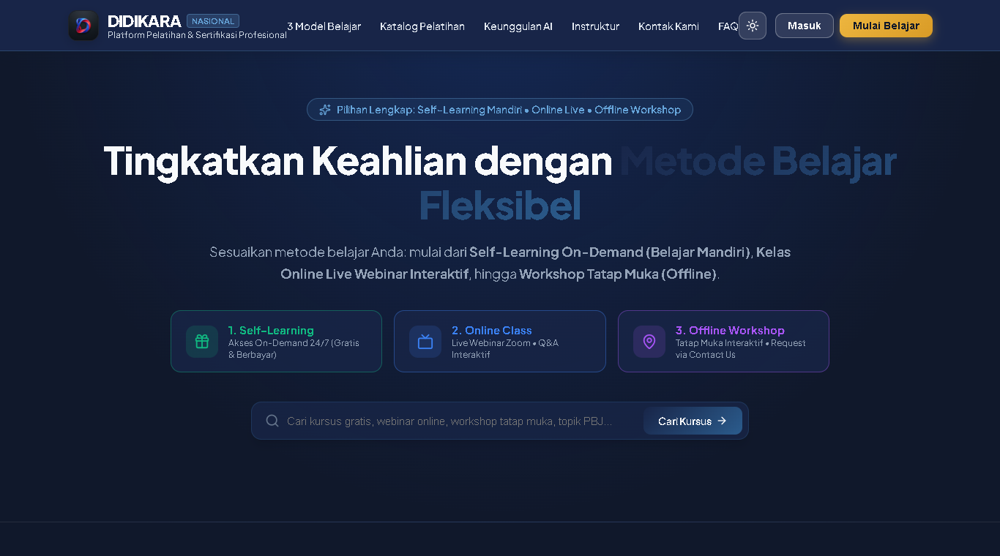
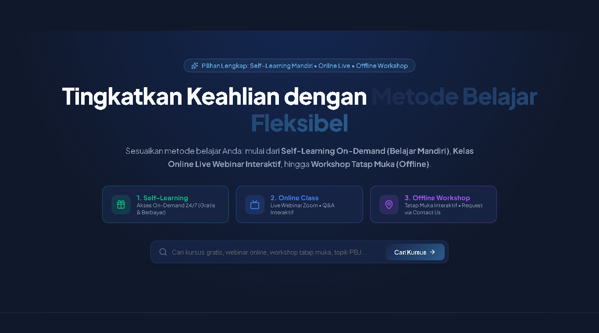
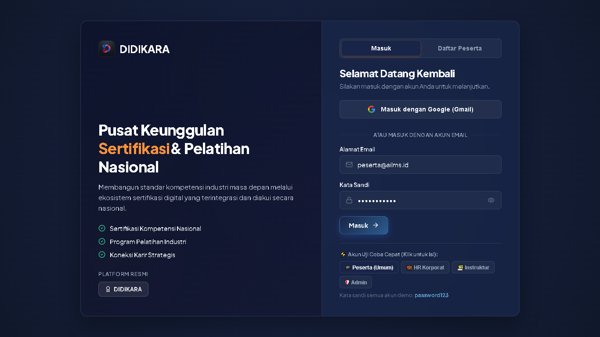
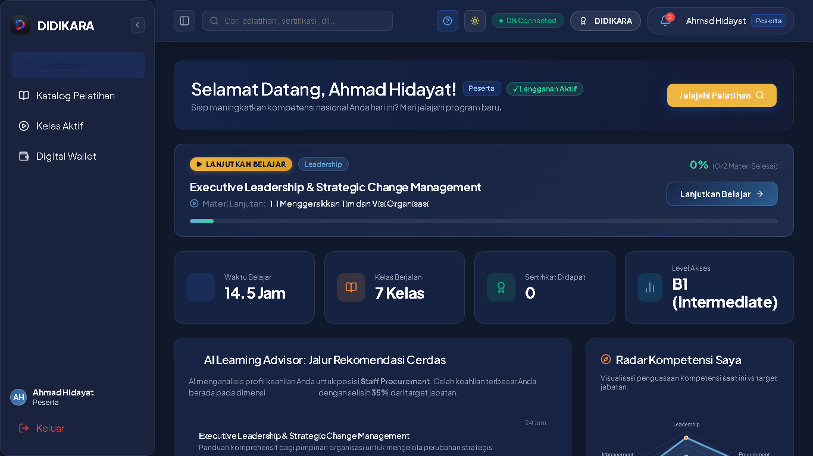
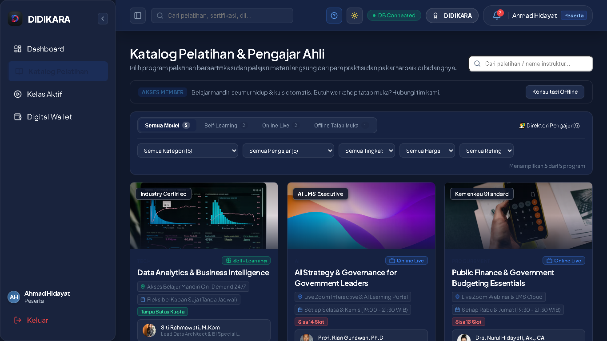
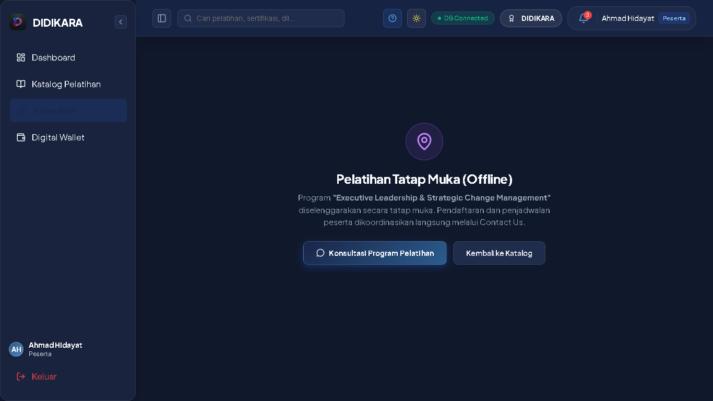
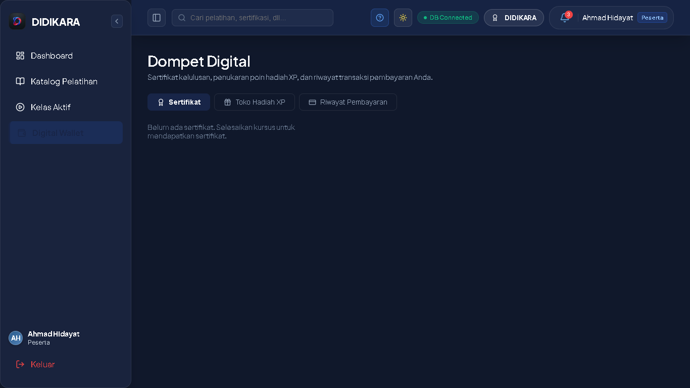
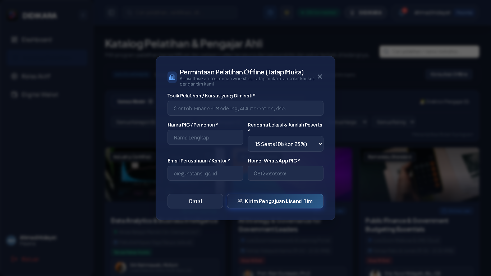
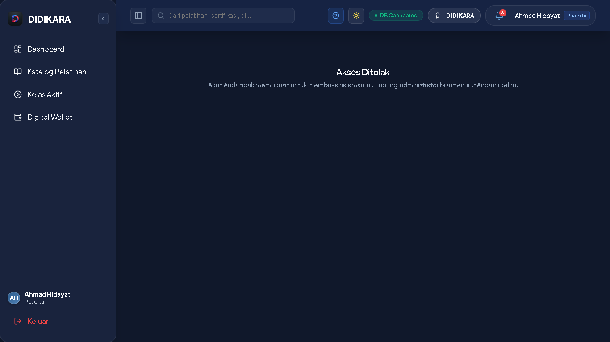

# 📖 BUKU PANDUAN PENGGUNA (USER MANUAL) RESMI DIDIKARA LMS

> **Sistem Manajemen Pembelajaran & Pelatihan Kompetensi Terpadu**  
> **Aplikasi Live:** [https://didikara.vercel.app](https://didikara.vercel.app)  
> **Segmen Pengguna:** Peserta Umum (B2C), Karyawan & HR Perusahaan (B2B), serta Instruktur Praktisi

---

## 1. PENDAHULUAN & GAMBARAN UMUM APLIKASI

**DIDIKARA LMS** adalah platform pelatihan kompetensi modern yang dirancang untuk menjembatani kebutuhan peningkatan keahlian kerja bagi **Peserta Umum (Profesional/Mahasiswa/Pencari Kerja)** dan **Karyawan Perusahaan (B2B Corporate L&D)** dengan bimbingan langsung dari **Praktisi Industri Berpengalaman**.

Platform ini mendukung **3 Model Pembelajaran Terpadu**:
1. **Self-Learning (Belajar Mandiri On-Demand):** Pembelajaran video berkualitas tinggi dengan *Focus/Cinema Mode*, modul interaktif SCORM 1.2, kuis per modul, dan ujian kompetensi mandiri.
2. **Online Live (Webinar Interaktif):** Kelas virtual daring terjadwal menggunakan integrasi Google Meet / Zoom dengan presensi kehadiran waktu-nyata (*real-time attendance*).
3. **Offline Tatap Muka (Workshop Intensif):** Pelatihan luring langsung di lokasi (*training center* / hotel) dengan kuota kursi terbatas dan materi praktikal.

---

## 2. PANDUAN PENGUNJUNG: BERANDA & LANDING PAGE

Halaman utama (Landing Page) menyajikan informasi lengkap mengenai program pelatihan, model belajar, dan opsi akses keanggotaan.

### Elemen Utama Landing Page:
- **Hero Banner:** Menampilkan tajuk *"Tingkatkan Keahlian dengan Metode Belajar Fleksibel"* dengan navigasi instan menuju katalog.
- **Pilihan 3 Model Belajar:** Tiga kartu pintas interaktif untuk memfilter langsung kelas belajar mandiri, kelas webinar daring, atau workshop tatap muka.

- **Bilah Navigasi Atas:** Akses cepat ke Beranda, Katalog Pelatihan, Portal AI, Layanan Korporat, serta Tombol **"Masuk Akun"**.

---

## 3. PANDUAN MASUK AKUN (LOGIN & AUTENTIKASI)

Untuk mengakses kelas, dasbor belajar, atau dasbor instruktur, pengguna masuk melalui halaman login terpadu.

### Langkah-Langkah Masuk:
1. Buka tautan login di pojok kanan atas atau akses langsung [https://didikara.vercel.app/dashboard](https://didikara.vercel.app/dashboard).
2. Masukkan **Alamat Email** dan **Kata Sandi**.
3. Klik tombol **"Masuk"**.
4. **Fitur Akun Uji Coba Cepat (Quick Demo):** Tersedia lencana 1-klik untuk mencoba peran secara instan:
   - `🎓 Peserta (Umum)`: `peserta@ailms.id` (Akses kelas & ujian belajar).
   - `💼 HR Korporat`: `hr@company.com` (Simulasi penugasan karyawan).
   - `👨‍🏫 Instruktur`: `budi.santoso@didikara.id` (Akses pengelolaan kelas & bagi hasil).
   - `🛡️ Admin`: `admin@digidaya.tech` (Akses penuh master data & platform).
   *(Seluruh akun demo menggunakan sandi seragam: `password123`)*.

---

## 4. PANDUAN PESERTA UMUM (LEARNER GUIDE)

### 4.1. Dasbor Pembelajaran Peserta
Setelah berhasil masuk, peserta disambut di dasbor terpusat yang memuat seluruh ringkasan aktivitas belajar.

- **Statistik Belajar:** Menampilkan total jam pelatihan terselesaikan, jumlah sertifikat yang diraih, dan skor kompetensi.
- **Kartu "Lanjutkan Belajar" (*Resume Learning*):** Menampilkan kelas aktif terakhir yang sedang dipelajari beserta persentase progres. Klik **"Lanjutkan"** untuk langsung membuka video di detik terakhir tanpa harus mencari manual.
- **Radar Kompetensi:** Visualisasi grafik tingkat keahlian peserta (skala A1 Dasar hingga C2 Mahir).

---

### 4.2. Eksplorasi Katalog Pelatihan
Katalog pelatihan dirancang bersih (*clean*), proporsional, dan mudah disaring sesuai kebutuhan karier.

- **Pencarian Cepat:** Ketik judul topik atau nama instruktur di kolom pencarian.
- **Tab Model Belajar:** Beralih antara *Semua Model*, *Self-Learning*, *Online Live*, dan *Offline Tatap Muka*.
- **Dropdown Filter:** Saring kelas berdasarkan Kategori (AI, Tech, Leadership, Procurement), Tingkat (Dasar s/d Eksekutif), Kisaran Harga (Akses Member vs Berbayar), dan Rating Instruktur.
- **Kartu Pelatihan:** Memuat thumbnail video, badge model belajar, durasi materi, tingkat kesulitan, snippet profil instruktur ahli, serta tombol aksi **"Buka Kelas"** atau **"Akses Member"**.

---

### 4.3. Belajar di Kelas Aktif (Ruang Kelas LMS)
Ruang kelas menghadirkan pengalaman belajar minim gangguan (*distraction-free learning*).

1. **Pemutar Video dengan Mode Sinema (*Focus Mode*):** Klik tombol Sinema untuk melebarkan pemutar video dan menyembunyikan bilah samping agar fokus belajar maksimal.
2. **Silabus Interaktif (Kanan):** Daftar bab (*chapters*) dan materi pelajaran dengan indikator centang hijau saat tuntas dipelajari.
3. **Tab Pembelajaran Terpadu:**
   - **Overview:** Rangkuman materi, deskripsi kursus, dan tujuan kompetensi.
   - **Catatan Pribadi (*Notes*):** Mencatat poin penting yang otomatis tersimpan per bab.
   - **Tugas (*Assignments*):** Mengunggah berkas jawaban tugas untuk dinilai instruktur.
   - **Ujian CBT:** Pintu masuk evaluasi akhir berbasis komputer.
   - **Presensi:** Check-in kehadiran untuk kelas webinar atau tatap muka.
   - **Forum Tanya Jawab:** Berdiskusi dan bertanya langsung kepada instruktur kursus.
   - **Live Class:** Tautan langsung masuk ke ruang virtual Zoom/Meet saat jadwal live tiba.
   - **Asisten AI:** Bantuan tanya jawab interaktif seputar silabus materi secara 24/7.

---

### 4.4. Mengerjakan Ujian Akhir CBT (*Computer Based Test*)
Untuk meraih sertifikat resmi, peserta wajib menyelesaikan ujian kompetensi.

- **Hitung Mundur (*Timer*):** Ujian dibatasi waktu dengan mekanisme *auto-submit* otomatis jika waktu habis.
- **Soal Acak:** Urutan soal diacak untuk menjamin integritas evaluasi.
- **Ambang Batas Kelulusan (*Passing Grade*):** Nilai langsung keluar seketika setelah tombol kirim ditekan. Bila melampaui passing grade (misal: 75%), sertifikat digital akan langsung diterbitkan secara instan.

---

### 4.5. Digital Wallet & Verifikasi Sertifikat
Setiap keberhasilan belajar terekam dalam portofolio digital peserta.

- **Saldo Poin / Cashback:** Poin yang terkumpul dari penyelesaian kelas dapat ditukarkan (*redeem*) menjadi potongan harga pelatihan berikutnya.
- **E-Sertifikat Digital:** Unduh sertifikat format PDF berkualitas cetak dengan nomor registrasi unik.
- **QR Code Validasi Publik:** Sertifikat dilengkapi tautan verifikasi resmi [https://didikara.vercel.app/verify/[certId]](https://didikara.vercel.app/verify/[certId]) yang dapat dibagikan kepada rekruter, bagian HRD kantor, atau dicantumkan di profil LinkedIn untuk membuktikan keaslian tanpa risiko pemalsuan.

---

## 5. PANDUAN KARYAWAN & HR KORPORAT (B2B GUIDE)

DIDIKARA memfasilitasi kebutuhan pelatihan terstandar untuk divisi kerja, tim operasional, dan korporasi.

### 5.1. Pengajuan Lisensi Tim (*Multi-Seat Discounts*)
Bagi perwakilan perusahaan atau manajer tim yang ingin mendaftarkan banyak karyawan sekaligus:

1. Buka menu **Katalog Pelatihan**, lalu klik tombol **"Konsultasi Offline / Lisensi Tim"**.
2. Isi formulir pengajuan:
   - Topik pelatihan yang dibutuhkan tim.
   - Nama PIC & nomor WhatsApp kantor.
   - Pilihan paket kuota: **5 Seats (Diskon 15%)**, **15 Seats (Diskon 25%)**, **50 Seats (Diskon 40%)**, atau **100+ Seats (Enterprise Custom)**.
3. Klik **"Kirim Pengajuan Lisensi Tim"** atau hubungi langsung via WhatsApp yang tertera.

### 5.2. Penugasan Pelatihan Karyawan (*Training Assignments*)
- Karyawan yang telah didaftarkan oleh HRD akan otomatis menerima pelatihan wajib di akun mereka.
- Setiap modul penugasan memiliki tenggat waktu (*deadline*). Karyawan cukup masuk ke akun dan menyelesaikan modul sesuai jadwal tanpa perlu membayar sendiri.
- HRD memantau penyelesaian modul karyawan melalui laporan kepatuhan jam pelatihan (*L&D compliance report*).

---

## 6. PANDUAN INSTRUKTUR PRAKTISI (INSTRUCTOR GUIDE)

Instruktur adalah mitra strategis yang mengampu materi dan membimbing peserta.

### 6.1. Hak Mengajar & Penugasan Resmi
Kewenangan mengajar di DIDIKARA ditetapkan secara spesifik per pelatihan (*Course-Instructor Mapping*):
- Instruktur hanya dapat mengelola, menilai tugas, dan membuat pengumuman pada kursus-kursus yang secara resmi ditugaskan kepadanya.
- Memiliki lencana khusus **"Instruktur Terverifikasi"** pada forum diskusi kursus.

### 6.2. Sesi Interaktif & Penilaian
- **Menyelenggarakan Live Webinar:** Membuka tautan Zoom/Meet bagi peserta yang terdaftar, membagikan kode token presensi, dan memantau daftar hadir peserta.
- **Penilaian Tugas (*Grading*):** Meninjau berkas tugas yang diunggah peserta, memberikan skor angka (0–100), dan menuliskan masukan konstruktif.

### 6.3. Dasbor Bagi Hasil & Pencairan Dana (*Instructor Payouts*)
Setiap penjualan kelas berbayar (satuan maupun korporat) dicatat dalam skema bagi hasil (*revenue sharing*) yang transparan.

- **Rekapitulasi Penjualan:** Instruktur dapat memantau status pesanan yang telah lunas (*paid orders*), porsi persentase bagi hasil, dan akumulasi saldo.
- **Siklus Pencairan (*Disbursement*):** Saldo yang belum dibayar (*unpaid*) akan diproses secara berkala ke rekening bank instruktur dan ditandai dengan nomor referensi transfer bank resmi.

---

## 7. PANDUAN PORTAL AI PERENCANAAN (AI PLANNER)

Fitur cerdas untuk membantu individu dan tim merancang peta jalan (*roadmap*) pembelajaran yang paling efektif.

1. Buka menu **"AI Portal Perencanaan"** pada bilah samping.
2. Masukkan posisi pekerjaan saat ini dan target karier/kompetensi yang ingin dicapai dalam 6–12 bulan ke depan.
3. Mesin AI DIDIKARA akan menganalisis kesenjangan keahlian (*skill gap*) dan merekomendasikan urutan modul pelatihan yang paling relevan untuk diambil secara bertahap.

---

## 8. TANYA JAWAB UMUM (FAQ)

**T: Apakah sertifikat yang diperoleh sah dan bisa dibuktikan keasliannya?**  
**J:** Ya, setiap sertifikat memiliki Certificate ID unik yang terhubung ke sistem verifikasi publik di `https://didikara.vercel.app/verify/[certId]` lengkap dengan QR Code yang dapat dipindai oleh siapa saja.

**T: Apa keuntungan berlangganan Akses Member dibanding beli satuan?**  
**J:** Akses Member memberikan hak akses tak terbatas (*unlimited*) ke seluruh katalog kelas *Self-Learning* selama masa langganan aktif. Sementara pembelian satuan biasanya dipilih untuk kelas interaktif *Online Live* atau *Workshop Tatap Muka*.

**T: Bagaimana jika ada kendala teknis saat memutar video atau ujian?**  
**J:** Peserta dapat menekan ikon bantuan / *support ticket* pada bilah navigasi atau menghubungi layanan bantuan resmi melalui WhatsApp yang tercantum pada formulir konsultasi.
